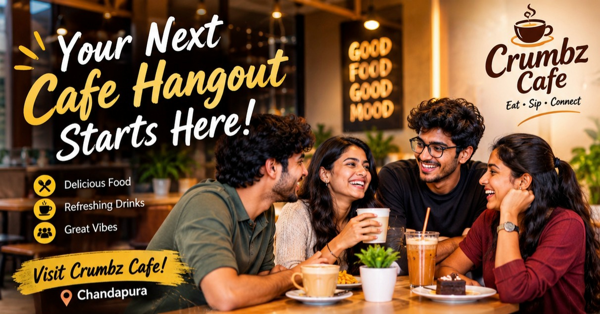
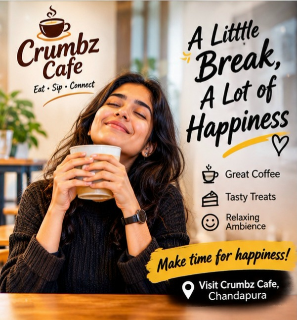
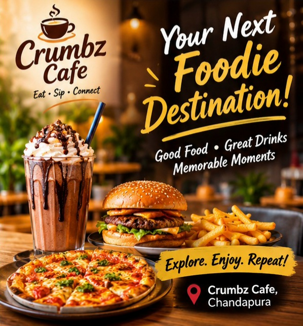

# Crumbz Cafe – AI-Powered UGC Ad Content Pack

## Project Overview

This project focuses on creating an AI-powered User Generated Content (UGC) advertising campaign for Crumbz Cafe, a local cafe in Chandapura, Bengaluru.

The campaign uses prompt engineering to develop engaging advertisement hooks, short-form video scripts, social media captions and content marketing strategies.

## Project Objectives

- Create engaging UGC-style advertisement concepts.
- Generate attention-grabbing marketing hooks.
- Develop short-form promotional video scripts.
- Prepare platform-specific social media captions.
- Apply AI prompt engineering techniques.
- Develop a content marketing strategy.

## Target Audience

- College students
- Young professionals
- Friends and social groups
- Cafe and food lovers

## Tools Used

- ChatGPT – AI content generation and prompt engineering.
- Google Docs – Project documentation.
- GitHub – Project publishing and version control.

## Project Deliverables

1. 10 UGC advertisement hooks.
2. 3 short-form video advertisement scripts.
3. Instagram, Facebook and YouTube Shorts captions.
4. AI prompt engineering documentation.
5. UGC content marketing strategy.
6. Advertisement creative mockups.
7. Campaign performance indicators.

## Project Files

- [View Complete Project PDF](Crumbz_Cafe_UGC_Ad_Content_Pack.pdf)

## Campaign Platforms

- Instagram Reels
- Facebook
- YouTube Shorts

## Expected Outcomes

- Improved local brand awareness.
- Increased audience engagement.
- Better promotional content ideas.
- Greater interest in cafe visits.

*These are expected outcomes, not measured campaign results.*

## Disclaimer

The advertisements and promotional concepts are AI-generated creative proposals. They are not verified customer testimonials or confirmed representations of the cafe's actual products and premises.

## Author

**Rekam Tejaswini**

Future Interns – Prompt Engineering Task 2

**Project Year:** 2026

---

## Advertisement Creative Gallery

This folder contains AI-generated promotional advertisement creatives developed for the Crumbz Cafe UGC advertising campaign.

### 1. Cafe Hangout

### 2. Coffee Break

### 3. Foodie Destination

